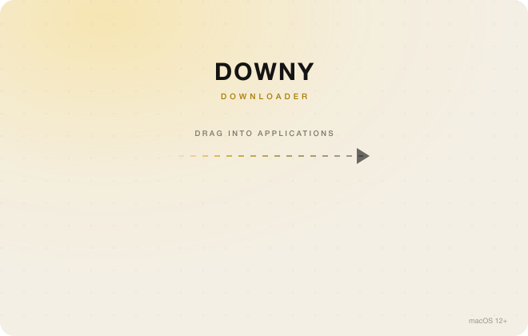

# Downy Downloader

A small, local macOS YouTube downloader. Paste a link, choose the quality, and download. No Python, Homebrew, or terminal setup required.



## Download

[Download the latest DMG](https://github.com/kaidamiani985-arch/Downy-Downer/releases/latest).

## Install

1. Download and open `Downy-Downloader-1.0.0-universal.dmg`.
2. Drag **Downy Downloader** into **Applications**.
3. The app is ad-hoc signed, not notarized with a paid Apple Developer certificate. On first launch, macOS may block it:
   - macOS 15 Sequoia or newer: **System Settings → Privacy & Security → Open Anyway**.
   - macOS 14 Sonoma or older: right-click the app and choose **Open**.
4. After the first launch, it opens normally.

Requires macOS 12 Monterey or newer. The DMG is universal: native Intel and Apple Silicon.

## Use

- Paste a YouTube video, Shorts, or playlist link and press **Add**.
- Select one or more queue items, choose video/audio and quality, then **Download**.
- Files go to the folder shown in the footer. The first download asks you to choose one.
- Normal downloads cost **5 tokens**.
- A complete playlist costs **`ceil(5 × videos ÷ 2)`** tokens:
  - 3 videos → 8 tokens
  - 10 videos → 25 tokens
- Partial playlist selections cost the normal 5 tokens per video.
- Failed or cancelled downloads refund automatically.
- You start with 0 tokens. The wallet in the top-right shows your balance, and the download cost is always shown before you start.
- If YouTube asks you to sign in, open **Settings → Under the hood → Browser cookies** and choose your browser.
- If YouTube changes and downloads stop working, open **Settings → Under the hood → Update yt-dlp**.
- To start over, open **Settings → Reset save**. This clears the queue and resets tokens to 0 while keeping your settings.

## What is bundled

- `yt-dlp 2026.10.26` (universal macOS binary)
- `Deno 2.9.8` for Intel and Apple Silicon (required for YouTube's JavaScript challenges)
- `FFmpeg` and `FFprobe` for Intel and Apple Silicon (merging streams and audio conversion)
- Inter and DM Mono fonts, licensed for local bundling

No external runtime is needed. On first launch, the app copies the binaries into:

`~/Library/Application Support/Downy Downloader/bin`

The in-app yt-dlp updater writes to that folder, so the app bundle can stay signed.

## Build from source

```bash
npm install
node node_modules/electron/install.js   # if your npm setup skips install scripts
npm run fetch:binaries
npm run make:icons
npm run typecheck
npm test
npm run dist:mac
```

The build produces:

- `release/Downy Downloader.app` (universal)
- `release/Downy-Downloader-1.0.0-universal.dmg`
- `release/SHA256SUMS.txt`

### Signing

`npm run dist:mac` ad-hoc signs the app. It temporarily moves the yt-dlp binary out of the bundle while deep-signing, then restores it and re-seals the outer app bundle. This avoids modifying the PyInstaller yt-dlp executable.

A warning-free install requires an Apple Developer ID certificate and notarization. The project is already structured for that: replace the ad-hoc signing step in `scripts/package-mac.mjs` with a Developer ID identity and notarize the resulting app/DMG.

## Verification

- Unit tests cover playlist pricing, refund allocation math, URL parsing, and duration formatting.
- The main queue and playlist surfaces were checked with the Impeccable design detector and report zero findings.
- End-to-end tested with a real YouTube video:
  - 360p MP4 download
  - MP3 128 kbps audio extraction
  - playlist import and 50% group pricing
  - token charging and wallet updates
- Universal app slices verified with `lipo`.

## Notes

- Everything stays on this Mac. No analytics, accounts, or telemetry.
- Public videos work out of the box. Age-restricted, private, or members-only videos may require browser cookies or may not be available.
- Live streams are not supported yet.
- Download only content you have the rights to, and follow YouTube's terms.
